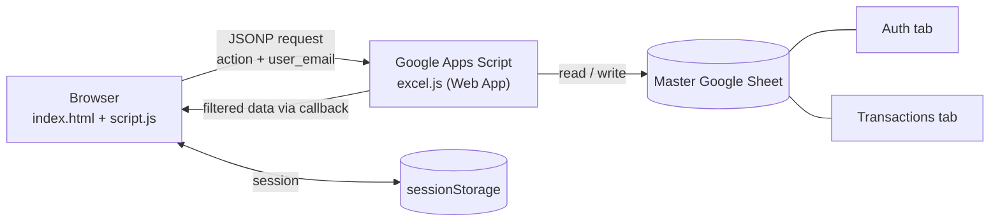

# Expense Tracker

A simple multi-user expense tracker that runs without a server or a paid database. Your Google Sheet is the database, and a Google Apps Script web app is the API. The frontend is plain HTML, CSS and JavaScript, so you can run it by just opening the file in a browser.

Several people can use the same sheet. Each user only sees their own transactions.

## Features

- Sign up and log in with email and password
- Stays logged in when you refresh the page
- Change your own password from inside the app
- Works well on phones
- Charts to see where your money goes
- `Auth` and `Transactions` tabs are created in the sheet automatically

## How it works



The browser calls the Apps Script URL using a small JSONP helper (this avoids CORS errors). The script reads or writes the sheet, filters everything by `user_email`, and sends the result back. After login, the session is saved in `sessionStorage`, so a refresh doesn't log you out.

## Project structure

```
.
├── index.html   # UI: login/signup, entry modal, password change modal
├── style.css    # custom scrollbars and touch tweaks
├── script.js    # JSONP helper, session handling, Chart.js charts
└── excel.js     # Google Apps Script backend (pasted into Apps Script, not run locally)
```

## Setup

### 1. Clone the repo

```bash
git clone https://github.com/<your-username>/<your-repo-name>.git
cd <your-repo-name>
```

### 2. Create the backend

1. Create a new empty Google Sheet. You don't need to add any tabs or headers.
2. Go to **Extensions → Apps Script**, delete the default code, and paste in everything from `excel.js`. Save it.
3. Click **Deploy → New deployment**, choose **Web app**, and set:
   - Execute as: **Me**
   - Who has access: **Anyone**
4. Click **Deploy**, allow the permissions, and copy the Web app URL (it ends with `/exec`).

If you change `excel.js` later, deploy again and pick **New version**, otherwise the old code keeps running.

### 3. Add the URL to the frontend

Open `script.js` and put your URL on line 1:

```js
const GOOGLE_SCRIPT_URL = "https://script.google.com/macros/s/XXXXXXXX/exec";
```

### 4. Run it

Open `index.html` in your browser, or start a quick local server:

## Data isolation

All users share one sheet, but the API only returns rows that belong to the logged-in user.

- The email of the logged-in user is stored in `sessionStorage` and sent with every request.
- `excel.js` filters `Transactions` by `user_email` before sending anything back.
- New rows are saved with the user's `user_email`.
- Changing a password needs the current password first.

This setup is meant for personal or small group use. Keep the Google Sheet private, serve the site over HTTPS if you host it, and don't reuse an important password here. Since the data sits in a normal sheet, anyone with access to that sheet can read everything in it.

## Troubleshooting

| Problem                            | What to check                                                                                                                                                                                                                                                                                                                                                                                                                                                                                                                                                                              |
| ---------------------------------- | ------------------------------------------------------------------------------------------------------------------------------------------------------------------------------------------------------------------------------------------------------------------------------------------------------------------------------------------------------------------------------------------------------------------------------------------------------------------------------------------------------------------------------------------------------------------------------------------ |
| Login does nothing                 | `GOOGLE_SCRIPT_URL` on line 1 of `script.js` is correct and ends with `/exec`                                                                                                                                                                                                                                                                                                                                                                                                                                                                                                              |
| Code changes have no effect        | Redeploy the web app with a **New version**                                                                                                                                                                                                                                                                                                                                                                                                                                                                                                                                                |
| Permission or blank response error | Deployment is set to Execute as **Me** and access **Anyone**                                                                                                                                                                                                                                                                                                                                                                                                                                                                                                                               |
| Empty data after login             | Emails may differ by case or spaces, so trim and lowercase them                                                                                                                                                                                                                                                                                                                                                                                                                                                                                                                            |
| `JSONP request failed` in console  | Open `GOOGLE_SCRIPT_URL` directly in a browser tab (add `?action=get&email=test@test.com`). If it shows an `Exception: You do not have permission to call SpreadsheetApp...` (or `MailApp...`) page, the script was never fully authorized - deploying does **not** trigger the consent screen. In the Apps Script editor, run `authorizeAllScopes` once from the function dropdown, approve every permission, then redeploy with **New version**. Also confirm the deployment's **Who has access** is **Anyone** and that `GOOGLE_SCRIPT_URL` matches the active deployment's `/exec` URL |

## Contributing

Pull requests are welcome.

1. Fork the repo
2. Create a branch: `git checkout -b feature/your-feature`
3. Commit your changes and push
4. Open a pull request
